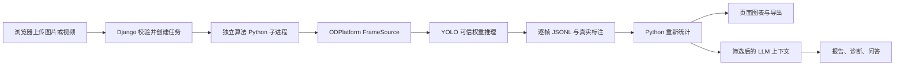

# 足球 Web 与算法、LLM 接入说明

## 分工和版本

你负责本模块的 Django Web、前端数据展示和 LLM；同学负责 ODPlatform 的数据处理、训练、模型评价和正式权重。老师 D0–D7 中的数据、配置、训练与推理流程作为理解项目的参考，不因为文档中的示例而改写同学的现有工程。

本次参考 ODPlatform `37de0071b0285f8a00517793b59d7f9d6653db39`、defect_manage `b3b647d5793dbdddd6d178a1e5e1585bc09e69e7`。后者目前仅包含基础台账，前者没有现成可用的足球 HTTP 服务，因此在新增模块中实现任务 API 和推理桥接。桥接优先复用 ODPlatform 的 `create_frame_source(source, stride=1)` 逐帧读取，并在新增适配层按源帧号执行采样，再以 Ultralytics 对可信权重执行 `predict`。这样可规避上游在最后一帧被跳过时误报 EOF 的情况，不改同学的模型代码或训练配置。



## 同学需要提供什么

1. 确认可信的足球四类 `best.pt`，类别名称为 `ball`、`goalkeeper`、`player`、`referee`。类别编号次序可不同，由权重的 `names` 映射名称，不能把编号当作固定语义。
2. 提供可运行该权重的 Python 解释器和依赖说明；在该解释器中确认 PyTorch、Ultralytics、OpenCV 可导入。需要复用最新 FrameSource 时，其导入依赖也应齐全。
3. 尽量提供 `model_metadata.json`：`model_sha256` 或 `weight_sha256`、`run_id`、`model_version`、`class_names`、数据指纹、用途和数据局限。SHA256 与实际权重不一致时拒绝运行。
4. 提供正式测试报告。Web 不从置信度生成准确率，不擅自替同学宣布最终效果。
5. 如果已有离线检测输出，也可以提供下面的 JSON 契约，先完成页面与 LLM 集成。

## 配置位置

配置只写在新增的 `football_portal/.env`，复制 `.env.example` 后填写。相对路径全部相对于 `defect_manage` 根目录。

| 配置项 | 含义 |
| --- | --- |
| `FOOTBALL_MODEL_PATH` | 明确指定的可信 `.pt` 权重 |
| `FOOTBALL_MODEL_METADATA` | 对应元信息，可留空；留空时不能宣称来源已完整核验 |
| `FOOTBALL_MODEL_LABEL` | 页面上的人类可读名称，可注明“联调示例”或“正式模型” |
| `FOOTBALL_MODEL_DIR` | 可选的可信权重目录，仅扫描该目录第一层 `.pt` |
| `FOOTBALL_INFERENCE_PYTHON` | 算法解释器；留空使用当前 Web 解释器，这时需自行具备算法依赖 |
| `FOOTBALL_PLATFORM_ROOT` | ODPlatform 根目录，供 FrameSource 导入使用 |
| `FOOTBALL_DEVICE` | 如 `cpu` 或算法环境支持的 GPU 编号 `0` |
| `FOOTBALL_DEMO_IMAGE_PATH` | 可选的可信本机示例图；页面示例按钮真实调用模型 |
| `FOOTBALL_MAX_FRAMES` | 每个任务最多处理的采样帧数，默认 1500；达到上限需显示截断限制 |
| `FOOTBALL_JOB_TIMEOUT` | 算法任务时限，默认 900 秒 |
| `FOOTBALL_LLM_API_KEY` | 本项目独立 LLM 密钥，仅服务端读取 |
| `FOOTBALL_LLM_BASE_URL` | 默认 `https://api.deepseek.com`，支持兼容接口；远程服务必须 HTTPS |
| `FOOTBALL_LLM_MODEL` | 默认 `deepseek-flash`，以实际服务商支持为准 |
| `FOOTBALL_LLM_INPUT_PRICE_PER_MILLION` | 可选的输入 token 单价，用于估算，不替代实际账单 |
| `FOOTBALL_LLM_OUTPUT_PRICE_PER_MILLION` | 可选的输出 token 单价，与输入单价采用相同货币 |

配置改动后重启本模块。网页不允许提交服务器路径或任意模型文件。权重 SHA256、元信息中的白名单字段可展示；服务器绝对路径和密钥不进入状态 API。

## HTTP API

基础路径为 `/football/api/`，URL 末尾保留 `/`。成功响应一般为 JSON，错误响应包含 `error` 与 `code`。先访问 `/football/` 建立浏览器会话和 CSRF cookie。所有修改请求携带 `X-CSRFToken`，浏览器端已自动处理。

| 方法和相对路径 | 参数或说明 |
| --- | --- |
| `GET status/` | 返回模型、LLM 就绪状态、上传限制、示例是否可用、功能边界 |
| `GET models/` | 返回可信模型列表；上传前从这里取得 `model_id` |
| `GET jobs/` | 当前会话最近 100 个任务；含状态、摘要和可用下载地址 |
| `POST jobs/` | multipart：`file`、`model_id`、`conf`、`imgsz`、`stride`；返回 `201 {job}` |
| `GET jobs/<id>/` | 任务详情；已完成时 `job.result` 是分析结果 |
| `POST jobs/<id>/cancel/` | 请求取消本会话正在排队或处理的任务 |
| `GET jobs/<id>/artifact/<key>/` | 按白名单下载本会话任务产物 |
| `POST demo/` | JSON：`model_id`、`conf`、`imgsz`、`stride`；从服务端配置的示例图创建真实任务 |
| `POST import/` | multipart `file` 或 JSON 结果对象；也接受 `{payload: ...}` |
| `POST assistant/` | JSON：`job_id`、`mode`、`question`、`history`；报告和诊断要求任务已完成 |
| `POST local-summary/` | JSON：`job_id`；生成明确标记的本地统计解读 |
| `GET assistant/history/?job_id=<id>` | 当前会话的解释记录，可按任务筛选 |
| `GET usage/` | 当前会话最近 100 条解释记录及已知 token 统计，缺失值不猜测 |

`conf` 默认 0.25，范围 0.001–0.99；`imgsz` 默认 960，范围 320–1536 且须为 32 的倍数；`stride` 默认 1，范围 1–30。图片默认上限 15 MB、视频 200 MB。图片还进行格式解码和像素规模检查；视频格式由算法进程读取验证。

任务状态有 `queued`、`running`、`completed`、`cancelled`、`failed`。前端轮询进度，只有 `completed` 的结果才能当作完整任务统计。视频达到采样帧上限时，结果 `source.truncated` 为真，并在 `analysis.limitations` 说明未覆盖完整视频。

`artifact` 支持 `original`、`annotated`、`video`、`frames`、`counts`、`result`、`report`、`preview`；实际不存在的产物不会给出地址。接口返回的 `artifact_urls` 可直接用于当前会话页面。上传文件不通过公开媒体目录提供，其他浏览器会话访问任务或产物返回 404。

## 离线 JSON 导入契约

最小可用示例：

```json
{
  "frames": [
    {
      "frame_index": 0,
      "timestamp": 0.0,
      "image_size": {"width": 1280, "height": 720},
      "boxes": [
        {"cls": "player", "conf": 0.87, "x1": 100, "y1": 150, "x2": 140, "y2": 260, "team": "A"},
        {"cls": "ball", "conf": 0.43, "x1": 310, "y1": 350, "x2": 320, "y2": 360}
      ]
    },
    {
      "frame_index": 2,
      "timestamp": 0.08,
      "image_size": {"width": 1280, "height": 720},
      "boxes": []
    }
  ]
}
```

这是契约示意数字，不是实验结果。也支持单帧顶层对象或单帧 `preview`。多帧任务必须提供完整 `frames`，不能把只有预览帧的轻量 API 响应当作完整视频导入。空检测帧必须保留 `boxes: []`，否则有足球帧比例等统计会发生偏差。

- `frame_index` 为源视频非负整数帧号，任务内不能重复；`timestamp` 为非负秒数，可未知。
- 坐标默认原图像素 `xyxy`，要求框面积为正、无负数、不越出图像。也支持 `xyxy: [x1,y1,x2,y2]`。
- 归一化坐标必须显式注明帧的 `coordinate_space: "normalized"` 并提供原图尺寸；后端再恢复像素坐标。
- `cls` 优先使用四类英文名称，也兼容中文别名。若 `cls` 是数字，顶层必须提供明确的 `class_names` 列表，不能猜测编号。
- `conf` 是 0–1 的有限数值。可选 `n_detections` 必须与实际框数一致。
- `team` 仅用于 `player`，允许 `A`、`B`；其他或缺失统一为 `unknown`。本次真实桥接没有球队分类器，不能自行生成 A/B。
- 导入上限 4 MB，并受本机帧数限制。拒绝只提供汇总数字、NaN/Infinity 或不合法框的报告。

后端重新计算统计，**不信任导入文件自带的汇总、精度或模型身份**。导入结果标记为 `unverified_import`；不能借导入内容宣称已核验模型来源，也不会导入任意远程图片链接。

## 统一输出

`schema_version` 为 `football.portal.result.v1`，包含：

| 字段 | 语义 |
| --- | --- |
| `source` | 图片/视频/导入、图像尺寸、帧率、实际读取器、是否截断 |
| `model` | 模型标识、显示名称、权重 SHA256、经过筛选的元信息 |
| `parameters` | 置信度、输入尺寸、步长和 NMS IoU |
| `preview` | 首个处理帧的源帧号、秒数、尺寸、全部检测框 |
| `boxes`、`best_class`、`best_conf` | 兼容字段；`boxes` 是预览帧全部框，最高置信度类别/分数仅为摘要 |
| `analysis` | 从真实逐帧框重新计算的全部统计和定义、局限 |
| `artifacts` | API 响应中为本会话可访问的地址；本地产物 JSON 中为文件名 |
| `execution` | 真实桥接为 `trusted_weight_inference`；注入检测器的程序测试明确另行标记 |

规范化检测框保留 `cls/conf/x1/y1/x2/y2`，补充规范类别编号、`cx/cy/w/h` 和球队属性。规范编号次序由本模块 `CLASSES` 决定，不等于任意原始模型的编号次序。

`frames.jsonl` 一行一帧，保留完整多框；`counts.csv` 一行一帧，含四类框数及 A/B/unknown；可下载的 `result.json` 包含完整 `frames`、元信息、预览帧和分析，可用于完整再导入。数据库和轮询 API 保留轻量结果，避免每次轮询传输全部框。图片生成真实 `annotated.png`；新任务另保存原始 `preview.png`，供足球局部放大使用。视频优先生成浏览器可播放的 VP8 WebM，编码器不可用时尝试 MP4。处理速度由硬件、模型、分辨率和步长决定，当前适合本机离线展示。

`annotation_style` 记录展示版本 `football.roles.v2`、`confidence_only`、角色颜色和足球突出标记。图片和视频采用同一绘制器：球员青色、门将紫色、裁判橙色、足球亮黄色，图上不再画英文角色名。原始类别、置信度、坐标均保留；足球圆环及局部放大不影响检测与评估。历史图片打开时可按保存的框重绘；历史视频要重新创建任务才能生成新版标注录像。

当前队列是 `ThreadPoolExecutor(max_workers=1)`，适合本机单进程展示；数据库会保存任务状态，但服务意外中断后不会自动续跑未完成任务。重新启动后，应重新提交中断任务，不能把它宣称为生产任务系统或断点恢复方案。

## LLM 读取什么

LLM 只读取 `build_context` 白名单中的任务状态、模型标识/指纹、参数、逐类和逐帧统计、数据局限；不上传原媒体，不读取任意 JSON 提示词，不发送本机路径或密钥。服务端把系统约束、选定模板、经过筛选的上下文和问题组合后调用接口。

`assistant/` 的 `mode` 可为 `report`、`diagnosis`、`chat`；需提供非空 `question`，报告模式例如“请基于本任务统计生成分析报告，并列出统计局限”。`history` 是 `role/content` 列表，仅接受 user/assistant，后端截断长度。没有本项目密钥返回 `503 LLM_NOT_CONFIGURED`，由使用者选择本地统计解读，不自动伪造回答。

本地用量审计只写调用元信息和 token，不写原始媒体或密钥；页面解释记录保存在独立数据库。真实回答可能出错，课程答辩引用时应与页面数字和同学的正式评测核对。缓存命中、服务商阶梯价格等因素可能影响账单，页面估算不能作为正式账单。

## 对接验收顺序

1. 用同学确认的权重替换 `.env`，核对页面 SHA256 和元信息；不通过编辑源码更换硬编码路径。
2. 用一张已知图片核对原图、标注图、全部框和 JSONL；最高置信度摘要不能遮盖其他框。
3. 用短视频核对源帧号、时间戳、处理步长、导出视频和每行统计；保留空检测帧。
4. 对照 JSONL、CSV 和页面总数，确认统计一致；导入离线结果时验证同样的规则。
5. 填写本项目 LLM 密钥后，用一个已完成任务做报告和问答，核对上下文、模型名、用量和限制。
6. 由两人共同确认正式权重、素材与答辩展示内容，再由你批准 Git 提交。当前尚未完成最终模型及真实 LLM 的联合验收。
